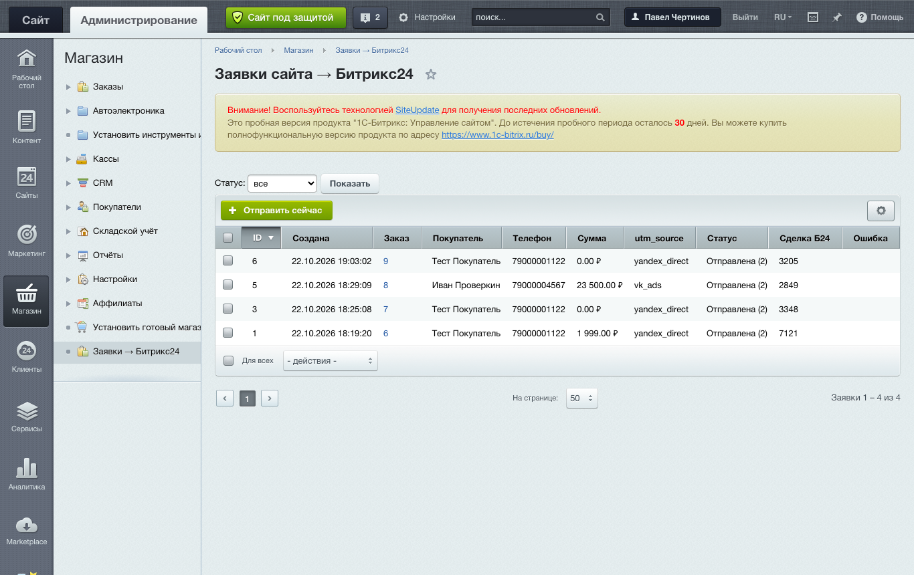
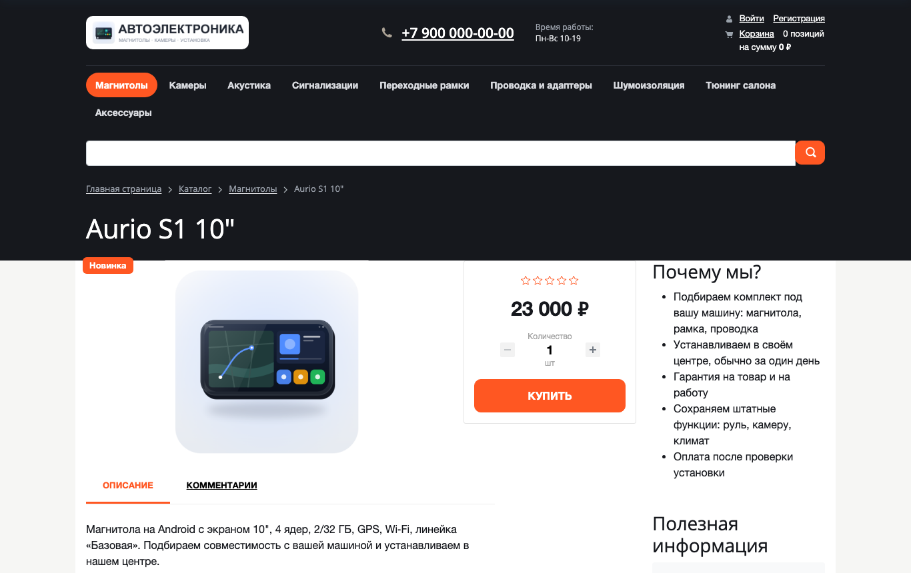
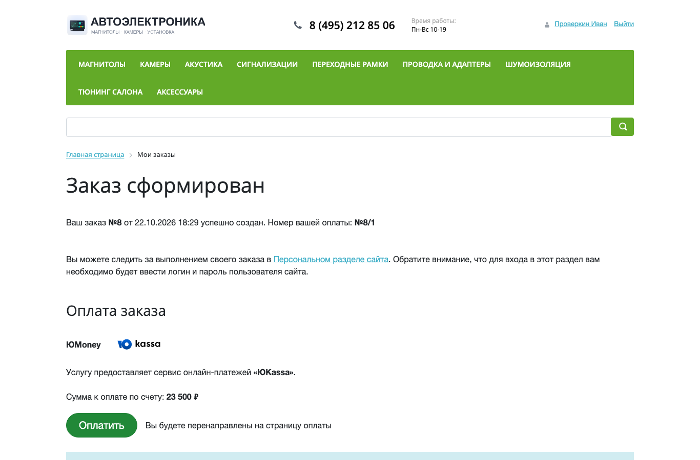
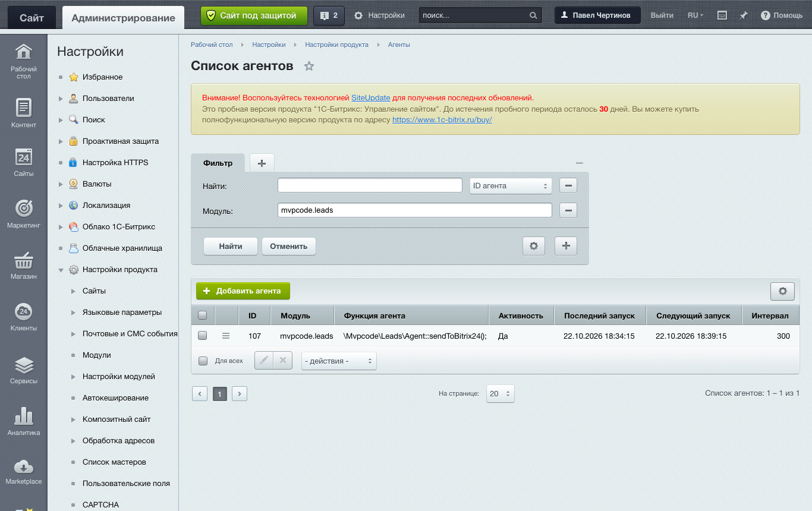

# bitrix-lab: заказы 1С-Битрикс → сделки Битрикс24

Локальный стенд «1С-Битрикс: Управление сайтом» с демо-магазином автоэлектроники и собственным модулем на D7 `mvpcode.leads`.
Модуль решает типовую задачу интернет-магазина: каждый заказ с сайта попадает в Битрикс24 сделкой вместе с источником рекламы, и ни одна заявка не теряется, даже если портал временно недоступен.



## Что делает модуль

1. Покупатель приходит по рекламе (`?utm_source=vk_ads`). Обработчик `main:OnPageStart` запоминает метку в cookie на 30 дней.
2. Покупатель оформляет заказ. Обработчик `sale:OnSaleOrderSaved` пишет заявку в свою таблицу: номер заказа, имя, телефон (приведён к виду 7XXXXXXXXXX), email, сумма, utm_source.
   Повторное сохранение заказа дубля не создаёт: уникальный ключ `EXTERNAL_KEY`.
3. Агент раз в 5 минут отправляет новые заявки в Битрикс24 методом `crm.deal.add` через входящий вебхук.
   Ошибка портала (503, лимит запросов, таймаут) не теряет заявку: она остаётся в очереди, счётчик попыток растёт, после пятой — статус «ошибка» с текстом ответа.
4. В админке «Магазин → Заявки → Битрикс24»: журнал с фильтром по статусу, кнопки «Отправить сейчас» и «Вернуть в очередь» (после исправления вебхука).
   Адрес вебхука задаётся в настройках модуля, проверяется формат https.

## Что внутри (D7)

| Файл | Что показывает |
|---|---|
| `lib/leadtable.php` | ORM `DataManager`: поля, типы, значения по умолчанию, уникальный ключ |
| `lib/eventhandlers.php` | обработчик события D7 `Bitrix\Main\Event`, работа с `Sale\Order` и свойствами заказа |
| `lib/utm.php` | обработчик `OnPageStart`, cookie |
| `lib/agent.php` | агент с пакетной обработкой, повторами и пределом попыток |
| `lib/bitrix24client.php` | REST Битрикс24 через `Bitrix\Main\Web\HttpClient`, разбор ошибок портала |
| `install/index.php` | установщик `CModule`: таблица, регистрация событий, агент, файлы админки; полное удаление |
| `admin/lead_list.php` | список `CAdminList` с групповыми действиями и проверкой прав модуля |
| `options.php` | страница настроек, `Bitrix\Main\Config\Option` |

Код модуля: [`src/local/modules/mvpcode.leads`](src/local/modules/mvpcode.leads). Папка `src/local` монтируется в `/local` сайта, ядро Битрикса в репозиторий не входит.

## Проверка

`src/local/tools/test_leads.php` прогоняет сценарий целиком на живом ядре: нормализация телефонов, создание заказа через Sale API, заявка с UTM, повторное сохранение без дубля, отправка в заглушку Битрикс24 (`mock_b24.php`), отказ портала с сохранением ошибки, успешная повторная отправка. Итог: 12 из 12.

Отдельно проверен заказ из браузера: заход с `?utm_source=vk_ads` → корзина → оформление → заявка в журнале с `vk_ads`.

## Стенд

```
docker compose up -d          # nginx + php 8.2-fpm + MariaDB 10.11 + Redis, http://localhost:8091
docker compose exec php php /var/www/html/local/tools/install_leads.php   # установить модуль
docker compose exec php php /var/www/html/local/tools/test_leads.php      # тесты
```

Дистрибутив Битрикса (пробная версия) ставится в `www/` мастером установки и в репозиторий не входит.
`import_autoelectronics.php` и `apply_theme.php` превращают демо-магазин одежды в магазин автоэлектроники: 9 разделов, 60 товаров со своими иллюстрациями, логотип, SEO-шаблоны инфоблока.

## Оформление без правки шаблона

Стандартный шаблон `eshop_bootstrap_v4` не копируется и не правится вручную, поэтому обновляется штатно:
- `local/php_interface/init.php` по событию `OnBeforeProlog` подключает `local/templates/.default/mvp-theme.css`: переменные темы, графитовая шапка и подвал, оранжевый акцент;
- меню каталога выводит свой шаблон компонента `bitrix:menu` — `local/templates/.default/components/bitrix/menu/mvp_top` (выпадающие подразделы, на телефоне горизонтальная лента);
- остальные изменения (переключение меню на свой шаблон, подвал, телефоны, SEO-шаблоны) делает скрипт `apply_theme.php`, его можно прогнать на чистой установке.

## Скриншоты

| | |
|---|---|
|  |  |
|  |  |
